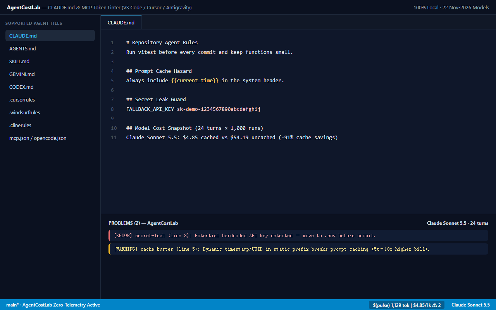

# AgentCostLab — CLAUDE.md & MCP Token Linter

Real-time token tax estimator, prompt cache-buster detector, and API key leak linter inside VS Code, Cursor, Windsurf, and Antigravity.



## Why Developers Install It

- **Stop Context & Bill Shock**: Know the exact token count and **1,000-run cached vs. uncached cost** of `CLAUDE.md`, `AGENTS.md`, `SKILL.md`, `GEMINI.md`, `CODEX.md`, `.cursorrules`, `.windsurfrules`, `.clinerules`, `copilot-instructions.md`, `opencode.json`, `mcp.json`, and `.mcp.json` before an agent loop burns your budget.
- **Catch Cache-Busters Instantly**: Highlights dynamic placeholders (`current_time`, `timestamp`, `Date.now`, `new Date`, `uuid`, `random`) inside static prefixes that silently break prompt caching and multiply multi-turn bills by 5x–10x.
- **Prevent API Key Leaks**: Flags hardcoded `sk-...`, `ghp_...`, `AIza...`, and `xoxb-` secrets directly in the Problems pane before commit.
- **Audit MCP Tool Bloat**: Counts MCP tool definitions, detects malformed JSON, and warns when static prefixes exceed 8,000 tokens.
- **22 Nov-2026 Models (10 Providers)**: Switch profiles across Anthropic (`Claude Sonnet 5.5`, `Opus 5.5`, `Fable 5.2`, `Haiku 5.5`), OpenAI (`GPT-6.2 Sol/Astra`, `GPT-6.1 Terra`, `GPT-6 Luna`), Google (`Gemini 4 Carbon/Neon/Argon/Hydrogen`), DeepSeek (`V4 Pro`, `V4.1 Flash`), Qwen (`Qwen4-Max`), Moonshot (`Kimi K3.1 Pro`), xAI (`Grok 4.7`), Z.ai (`GLM-5.3`, `GLM-5.3-Flash`), MiniMax (`MiniMax-M3`), and Mistral (`Large 4`, `Small 4`).
- **100% Local & Zero-Telemetry**: All analysis runs locally in the extension host with zero network calls. See [PRIVACY.md](PRIVACY.md).

## Commands

- `AgentCostLab: Inspect Prompt / MCP Token Tax` — Force-inspect any open file (even outside default filenames) and jump to Model Switcher or Web Simulator.
- `AgentCostLab: Select Pricing Model` — Switch between 22 supported LLM pricing profiles.
- `AgentCostLab: Open Web Cost Simulator` — Launch the full multi-turn $O(N^2)$ Pareto simulator at `https://jettlin927.github.io/agentcostlab/`.

## Packaging (`.vsix`)

```bash
npm run test
npm run package
```

Produces `dist/agentcost-lint-0.1.0.vsix` ready for VS Code Marketplace (`npx @vscode/vsce publish`) and Open VSX (`npx ovsx publish`).
